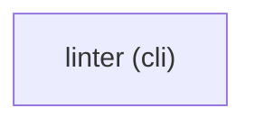

# Linter — Architecture

> The human-readable system shape. The machine-readable Project Registry is its
> own file, [registry.yaml](./registry.yaml). Tools parse that file and never
> read this doc.

## System Overview

The system is one self-contained code-checking CLI. It bundles the core checker
and every language add-on. A consuming repository installs nothing else.

The same configuration also reaches the code editor. A second entry point of
the same project serves it.

The whole system is client-side. It runs on developer machines and on CI
runners. No project is cloud-hosted. There is no shared package. The CLI and the
editor entry point share one base configuration inside the same project.

## Projects

### Linter (`cli`)

The linter is the only project. It has two entry points.

- The CLI entry point parses arguments, loads the consuming repository's
  configuration, and runs the checker.
- The editor entry point returns the same configuration to the code editor.

Both entry points build their result from the same base configuration. The
project owns that configuration and the language add-ons it bundles. It
persists no data, except an optional local cache file.

## How Projects Interconnect

There is one project, so no project calls another.

Both entry points read the consuming repository's configuration file. They find
it by walking up from the working directory. The editor loads the editor entry
point through the consuming repository's checker config file.

There is no auth flow. There are no accounts.

## Hosting & Deployment

The project ships as a public package on the npm registry. Developers run it on
their machines and in CI.

A tag starts an automated release pipeline. The pipeline:

1. Packs the package.
2. Verifies the package.
3. Publishes with trusted publishing.
4. Smoke-tests the published package on each supported platform.

A local publish exists as a fallback only. The weekly dependency-update pipeline
is disabled until its redesign.

## Registry

The machine-readable system description lives in
[registry.yaml](./registry.yaml). It holds the projects, dependencies, and the
cross-cutting selections. It is authoritative. This doc is its prose view.
