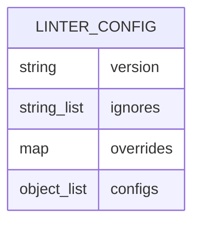

# Entities

<!-- Deliberately thin: a catalog plus ONE product-wide erDiagram. The diagram
     is a VIEW of the union of every entity's Relationships table (which stays
     authoritative) — same nodes and edges, nothing more. The coherence
     reviewer checks the two stay in sync. -->

## Entity catalog

| Entity                                    | Purpose (one line)                                                      |
| ----------------------------------------- | ----------------------------------------------------------------------- |
| [Linter Config](./linter-config/index.md) | The per-repository file `.config/linter.yaml` that customizes the tool. |

## Relationship view

