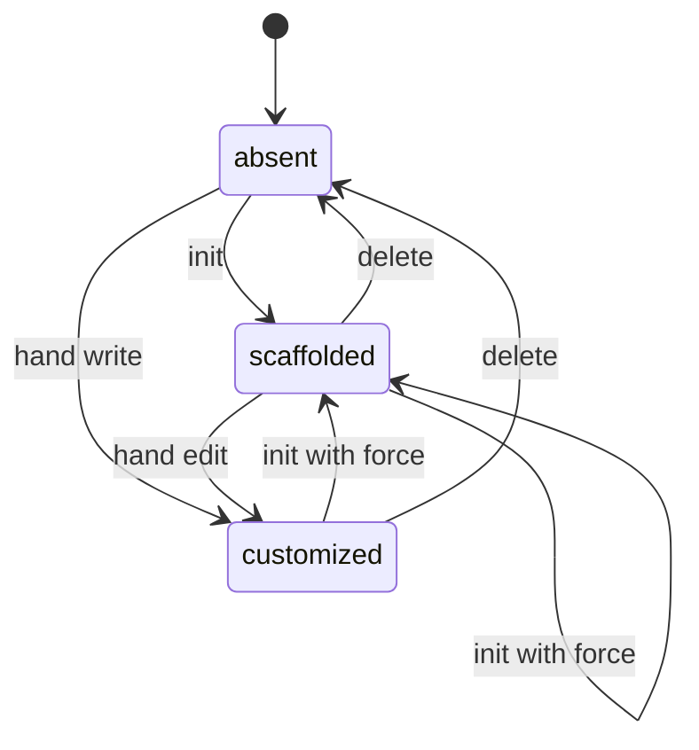

# Entity: Linter Config

## Purpose

The linter config is the one file a consuming repository uses to customize the
tool: extra ignore patterns, rule changes for a named preset, and raw checker
configuration objects. Location rule: [config](../../conventions.md#config).

Used by: [Onboard a repo](../../flows/linter/110-onboard-a-repo/index.md),
[Check a repo](../../flows/linter/120-check-a-repo/index.md),
[Editor feedback](../../flows/linter/140-editor-feedback/index.md).

Scale: one file per consuming repository; about 10 repositories within 3
months, driven by the goal
[own-repo adoption](../../product.md#goal-own-repo-adoption).

## Out of Scope

- The built-in presets and their default rules. This file only changes them.
- The editor setup file that the scaffold step also writes.
- Merging more than one config file.

## Lifecycle / State Machine

| From       | To         | Trigger (actor/system)                      | Guard               | Side effect                         |
| ---------- | ---------- | ------------------------------------------- | ------------------- | ----------------------------------- |
| absent     | scaffolded | Tool, in [onboard-a-repo][onboard] step 2   | No file exists      | Writes the file with `version: 1`   |
| scaffolded | customized | Developer edits the file by hand (no flow)  | None                | None                                |
| customized | scaffolded | Tool, init with the force flag              | Force flag is given | Overwrites the file; edits are lost |
| absent     | customized | Developer writes the file by hand (no flow) | No file exists      | None                                |
| scaffolded | scaffolded | Tool, init with the force flag              | Force flag is given | Rewrites the scaffold               |
| scaffolded | absent     | Developer deletes the file (no flow)        | None                | Runs use the default configuration  |
| customized | absent     | Developer deletes the file (no flow)        | None                | Runs use the default configuration  |

[onboard]: ../../flows/linter/110-onboard-a-repo/index.md

## Invariants

1. The file holds no secrets.
2. A preset name under `overrides` that the tool does not know, or an unknown
   key inside an `overrides.<preset>` entry, gives one warning on stderr, and
   it has no effect.
3. The tool's own checks reject with one outcome: exit code 1 and a one-line
   error on stderr. They reject a file that is not valid YAML, an empty file,
   a file whose root is not a mapping, a missing or unsupported `version`, and
   a top-level value of the wrong type. An empty file and a non-mapping root
   count as a missing version.
4. The tool does not check rule content itself. An unknown rule name, a
   severity outside the enum, an options value of the wrong shape, and invalid
   content in a raw `configs` object fail the run with exit code 1 and the
   checker's own error on stderr. So does a nested value of the wrong type: a
   preset entry that is not a mapping, `rules` that is not a mapping, an
   `ignores` item that is not a string, or a `configs` item that is not an
   object. This holds in `overrides.<preset>.rules` and in a raw `configs`
   object.
5. A rule override that gives only a severity keeps the preset's rule options.
   One that gives options replaces them.

## Data Model

Authoritative schema: [schema.yaml](./schema.yaml)

- An unknown top-level key gives a warning.

## Relationships

N/A — the linter config does not relate to any other entity.

## Concurrency & Consistency

- Concurrent-write resolution: N/A — one local file edited by one person; the
  last write wins.
- Baseline deviation: unknown top-level keys, unknown preset names and unknown
  keys inside a preset entry warn and are ignored, so the configuration stays
  forward-compatible. A missing
  `version` or a value of the wrong type is still rejected. Waiver:
  `baseline/boundary-validation/entities/linter-config`, see
  [baseline](../../conventions.md#baseline).
- Uniqueness guarantees under races: N/A — one file per repository path.
- Idempotency of each mutating action: init without the force flag leaves an
  existing file unchanged; init with the force flag writes the same scaffold
  each time.

## References

- [config](../../conventions.md#config)
- [baseline](../../conventions.md#baseline)
