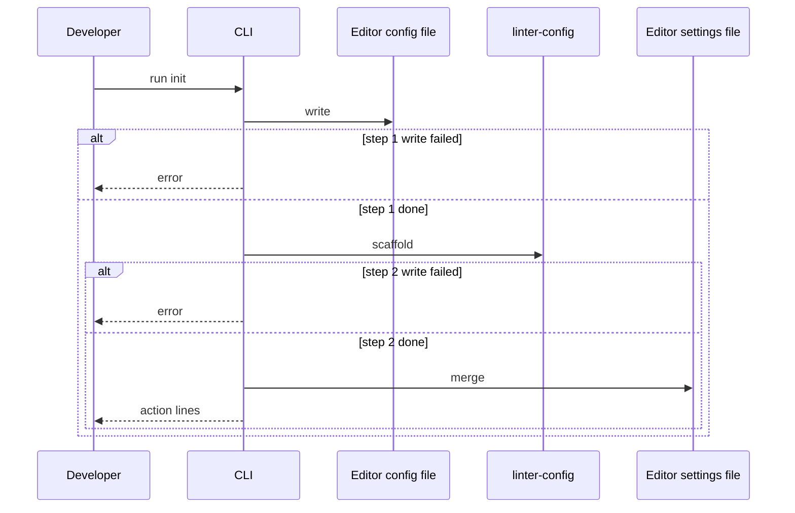

# Flow: Onboard a repository

## Purpose

A developer runs the CLI with the init flag in a working folder, normally the
repository root. The CLI writes the files that make the command line and the
editor use the same configuration. No other setup step follows.

Serves: [goal-own-repo-adoption](../../../product.md#goal-own-repo-adoption)

## Trigger & Actors

| Actor     | May trigger                                                                        | Authorization                         | Audit-recorded                                                                                                 |
| --------- | ---------------------------------------------------------------------------------- | ------------------------------------- | -------------------------------------------------------------------------------------------------------------- |
| Developer | Runs the CLI with the init flag in a working folder (normally the repository root) | Write access to the working folder    | no — the product has no audit foundation (a local CLI); the developer's own version control records the change |
| CLI       | Performs the steps; no pipeline or editor trigger exists                           | Runs with the rights of the developer | no — same reason                                                                                               |

## Steps

Init looks only in the working folder, for every file: a file in a parent
folder does not count and is never touched. Init creates files in the working
folder. It does not look for a repository root and never refuses or warns.

1. The CLI writes the editor config file. That file loads the same
   configuration as the CLI. If the file exists, the CLI skips it
   (`[skipped]`). With the force flag, it writes the file: `[overwritten]` if
   it existed, `[created]` if absent.
2. The CLI writes the configuration file with `version: 1` — touches
   [linter-config](../../../entities/linter-config/index.md) (absent →
   scaffolded; location per [config](../../../conventions.md#config)). The CLI
   creates its parent folder when missing. If the file exists, the CLI skips it.
   The force flag acts as in step 1 (`[overwritten]` or `[created]`).
3. If an editor settings file exists in the working folder, the CLI merges the
   setting that makes the editor use that configuration into it, and keeps its
   comments and trailing commas.
   - The setting is absent, or has a different value: the CLI sets it
     (`[updated]`).
   - The setting already has the right value: `[up-to-date]`.
   - The settings file is absent: the CLI never creates it or its folder
     (`[skipped]`).
   - Any failure (no JSON root, a syntax error, or a file that cannot be read
     or written): `[failed]` for that file, the run finishes, exit 1.
   - A leading byte-order mark is not an error; it stays.
   - The force flag has no effect: the merge runs as usual and never replaces
     the whole file.
4. The CLI prints one action line per file (`[created]`, `[overwritten]`,
   `[skipped]`, `[updated]`, `[up-to-date]` or `[failed]`). When a scaffold
   file was skipped, it adds a hint about the force flag. A skipped settings
   file does not count for the hint.

The editor config file and the editor settings file are not entities.

Output follows [Terminal UX](../../../design-system.md#terminal-ux): success
role for `[created]`, `[updated]`; warn for `[skipped]`; error for `[failed]`;
`[overwritten]` uses its label as is; `[up-to-date]` is plain text.

## Guarantees

| Step / group | Consistency     | On failure                                                                                                                                                                                                                                    | Idempotency                                          | Load & latency      |
| ------------ | --------------- | --------------------------------------------------------------------------------------------------------------------------------------------------------------------------------------------------------------------------------------------- | ---------------------------------------------------- | ------------------- |
| 1–2          | atomic per file | A failed write stops the run: a one-line error on stderr, no action lines, exit 1. A failed step 1 skips steps 2 and 3; a failed step 2 skips step 3. Files already written stay (no rollback). See [errors](../../../conventions.md#errors). | a second run without the force flag changes no file  | n/a — one local run |
| 3            | atomic per file | Any step 3 failure (no JSON root, syntax error, unreadable or unwritable file) prints `[failed]` for that file, leaves it unchanged, finishes the run and exits 1. Earlier files stay (no rollback).                                          | a second run changes nothing once the setting is set | n/a — one local run |
| 4            | atomic          | Exit 1 when the settings merge failed, else exit 0.                                                                                                                                                                                           | n/a                                                  | n/a — one local run |

## Diagram

## Acceptance

- Given an empty repository, when the developer runs init, then a lint run
  and the editor use the same configuration with no other install.
- Given a repository already onboarded, when the developer runs init a second
  time without the force flag, then no file changes and the exit code is 0.
- Given no editor settings file, when the developer runs init, then the CLI
  creates neither the file nor its folder and reports `[skipped]`.
- Given a settings file with a syntax error, when init runs, then that file
  stays unchanged, the CLI reports `[failed]` and exits 1.
- Given the setting has a different value, when the developer runs init, then
  the value is replaced and the CLI reports `[updated]`.
- Given scaffold files exist, when init runs with the force flag, then both
  are `[overwritten]` and the settings file is merged, never replaced whole.
- Given the CLI cannot write the editor config file, when init runs, then it
  stops with exit 1 and a one-line stderr error, and writes no later file.
- Given a configuration file exists only in a parent folder, when init runs in
  a child folder, then the CLI creates the files in the child folder.

## References

- [linter-config](../../../entities/linter-config/index.md)
- [config](../../../conventions.md#config) — where the configuration file lives
- [errors](../../../conventions.md#errors) — exit code and error stream rules
