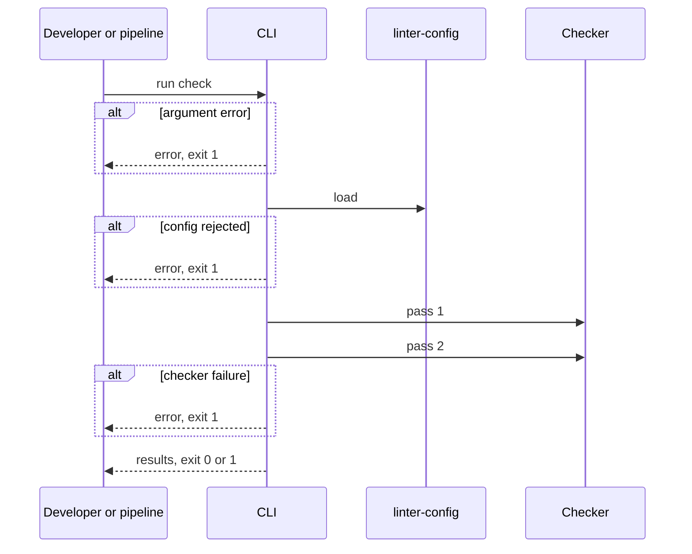

# Flow: Check a repository

## Purpose

A developer, or a pipeline, runs the CLI with files or folders as arguments.
The CLI checks them, reports the problems, and sets the exit code.

Serves: [goal-own-repo-adoption](../../../product.md#goal-own-repo-adoption)

## Trigger & Actors

| Actor                                             | May trigger                                                                   | Authorization                                            | Audit-recorded                                         |
| ------------------------------------------------- | ----------------------------------------------------------------------------- | -------------------------------------------------------- | ------------------------------------------------------ |
| Developer or pipeline (a CI job or a commit hook) | Runs the CLI with files or folders as arguments (default: the working folder) | Read access to the files; write access with the fix flag | no — the product has no audit foundation (a local CLI) |

## Steps

1. The CLI parses the arguments. An argument error stops the run before any
   file is checked: exit 1, a one-line stderr error.
   - The errors: an unknown flag, a flag without its value, a max-warnings
     value that is not a number, an unknown result format.
   - Result formats: the built-in formats of the checker (the checking engine
     bundled in the tool) — the default grouped human format, json,
     json-with-metadata, html — or a path to a format module.
2. The CLI loads [linter-config](../../../entities/linter-config/index.md) per
   [config](../../../conventions.md#config): it walks up from the working
   folder; if absent, it uses the default configuration.
   - A config the tool rejects (invariant 3 of the entity) stops the run: exit
     1, a one-line error on stderr, no results.
   - Unknown top-level keys, unknown preset names and unknown keys inside a
     preset entry warn on stderr, and the run continues.
3. The CLI builds the [linter-config](../../../entities/linter-config/index.md)
   configuration: the base presets, each preset override, the config ignores
   as global ignores, then the raw configs last.
4. Pass 1: the checker checks every matched file of each supported language.
   - A pattern that matches no file is not an error.
   - The run reads no ignore file. The built-in ignore list and the config
     ignores apply. The no-ignore flag turns both off.
   - With the cache flag, it checks only changed files. The cache location
     flag sets the path of the cache file or folder.
5. Pass 2: the checker checks the fenced code blocks of each Markdown file
   from pass 1 (not ignored) with the rules of each block's language. The CLI
   merges the two results per file. This pass never uses the cache.
6. With the fix flag, the CLI writes the fixes of pass 1 before pass 2, then
   the fixes of pass 2. The results list only the problems left.
7. With the quiet flag, the CLI keeps errors only. Dropped warnings do not
   count toward max-warnings. The fix flag still writes warning fixes.
8. The CLI prints the results on stdout in the selected result format; no
   problems, nothing printed. The debug flag adds checker output on stderr.
9. The CLI exits 1 when there is at least one error, or more warnings than the
   max-warnings value (no value: no limit). Else it exits 0.

Output and colors follow [Terminal UX](../../../design-system.md#terminal-ux).
The spinner shows on stderr only on a terminal after 1 second, never with
quiet or a non-default format.

## Guarantees

| Step / group | Consistency                                                   | On failure                                                                                                                                                                                                       | Idempotency                                                                                                                                                       | Load & latency      |
| ------------ | ------------------------------------------------------------- | ---------------------------------------------------------------------------------------------------------------------------------------------------------------------------------------------------------------- | ----------------------------------------------------------------------------------------------------------------------------------------------------------------- | ------------------- |
| 1–3          | atomic                                                        | An argument error or a rejected config stops the run before any file is checked: one-line stderr error, no results, exit 1. See [errors](../../../conventions.md#errors).                                        | n/a — nothing is written                                                                                                                                          | n/a — one local run |
| 4–6          | none — the files are read as they are when the run reads them | A failure of the checker itself (an unknown rule name, a bad rule setting, a file it cannot read or write) stops the run: the checker's error on stderr, exit 1, no partial results. Fixes already written stay. | A second run with the fix flag changes no file. A run after a failure that left some fixes written finishes the rest. Same files and configuration, same results. | n/a — one local run |
| 7–9          | atomic                                                        | none — read-only output                                                                                                                                                                                          | n/a — output only; nothing is written                                                                                                                             | n/a — one local run |

## Diagram

## Acceptance

- Given files with no problems, when the CLI runs, then it prints nothing and
  exits 0.
- Given one error, when the CLI runs, then it exits 1.
- Given warnings only, when the CLI runs, then it exits 0, unless there are
  more warnings than the max-warnings value.
- Given the same files and configuration, when the CLI runs on each supported
  platform, then the results are the same.
- Given a pipeline with only the package, when the CLI runs, then it checks
  the files with no other install.
- Given a Markdown code block with a violation, when the CLI runs, then it
  reports the problem under the rules of the block's language.
- Given the fix flag, when the CLI runs, then the output lists only the
  problems not fixed.
- Given an argument error or a rejected config, when the CLI runs, then it
  stops with exit 1 and a one-line stderr error before any file is checked.
- Given the checker fails, when the CLI runs, then it exits 1 with the
  checker's error on stderr and prints no partial results.
- Abuse case: n/a — a local caller acting with their own rights; no boundary
  to cross.

## References

- [config](../../../conventions.md#config),
  [errors](../../../conventions.md#errors),
  [testing](../../../conventions.md#testing),
  [reliability](../../../conventions.md#reliability),
  [design-system](../../../design-system.md#terminal-ux)
