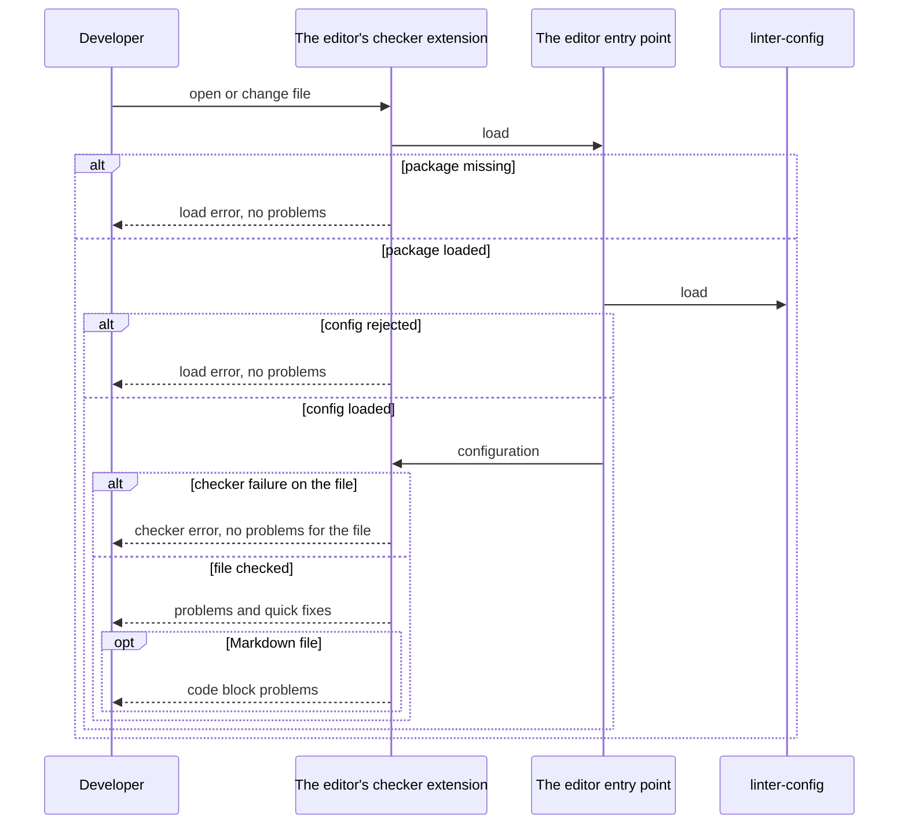

# Flow: Editor feedback

## Purpose

A developer opens or changes a file in an onboarded repository. The editor
shows the problems of the file, with the same rules and settings as the CLI.

Serves: [goal-own-repo-adoption](../../../product.md#goal-own-repo-adoption)

## Trigger & Actors

| Actor                          | May trigger                                                                                                             | Authorization                                                            | Audit-recorded                                                                                        |
| ------------------------------ | ----------------------------------------------------------------------------------------------------------------------- | ------------------------------------------------------------------------ | ----------------------------------------------------------------------------------------------------- |
| Developer                      | Starts the flow by opening or changing a file in a repository that ran [onboard-a-repo](../110-onboard-a-repo/index.md) | The developer's own rights on the files                                  | no — the product has no audit foundation; nothing is written except quick fixes the developer applies |
| The editor's checker extension | none — a system actor; it runs the flow                                                                                 | n/a — they run inside the developer's editor with the developer's rights | n/a — same as the developer row                                                                       |
| The tool's editor entry point  | none — a system actor; it runs the flow                                                                                 | n/a — they run inside the developer's editor with the developer's rights | n/a — same as the developer row                                                                       |

## Steps

1. The editor's checker extension reads the editor config file, which loads
   the tool's editor entry point from the package installed in the repository
   — touches none: files of the editor and the package, not data contracts.
2. The entry point loads
   [linter-config](../../../entities/linter-config/index.md) per
   [config](../../../conventions.md#config): it walks up from the working
   folder; if absent, it uses the default configuration.
   - The working folder is the root of the editor's workspace folder that
     holds the open file. The editor's checker extension sets it per workspace
     folder.
   - In a workspace with several roots, each root uses its own working folder
     and its own linter-config.
   - A file outside every workspace folder uses its own folder as the working
     folder: the walk-up starts there; if absent, the default configuration.
3. The entry point builds the same configuration as the CLI (the build step of
   [check-a-repo](../120-check-a-repo/index.md)) — touches
   [linter-config](../../../entities/linter-config/index.md) (read only).
4. The editor's checker extension checks the open file and shows its problems.
   Quick fixes come from the same rules. Touches none: files of the editor and
   the package, not data contracts. (failure: see Guarantees)
5. For a Markdown file, the editor's checker extension also checks the fenced
   code blocks with the
   rules of each block's language, as pass 2 of
   [check-a-repo](../120-check-a-repo/index.md) does — touches none: the same
   files as step 4.

A change to linter-config applies after the editor's checker restarts. There
is no automatic reload.

Screens: N/A — no screen platform; the editor's own surface shows the
problems. Background jobs: N/A — no worker. API operations: N/A — no service.

## Guarantees

| Step / group | Consistency                                                | On failure                                                                                                                                                                                                                         | Idempotency                                | Load & latency                        |
| ------------ | ---------------------------------------------------------- | ---------------------------------------------------------------------------------------------------------------------------------------------------------------------------------------------------------------------------------- | ------------------------------------------ | ------------------------------------- |
| 1–3          | atomic                                                     | A rejected config or a package not installed in the repository: the editor shows the load error from its checker extension and checks nothing. No fallback to another configuration. See [errors](../../../conventions.md#errors). | n/a — nothing is written                   | default — per conventions#reliability |
| 4–5          | none — the file is read as it is when the editor checks it | A failure of the checker on a file: the editor shows the checker's error from its extension and no problems for that file. Other files are not affected. A quick fix is a change the developer applies.                            | Same file and configuration, same problems | default — per conventions#reliability |

## Diagram

## Acceptance

- Given a repository after init, when a file opens in the editor, then the
  editor shows the same problems as the CLI shows for that file, including the
  problems in Markdown code blocks.
- Given a change to linter-config, when the editor's checker restarts, then the
  editor uses the new configuration.
- Given a rejected config or a missing package, when a file opens, then the
  editor shows the load error and no problems.
- Given the package installed in the repository and no other checker package,
  when a file opens, then the editor shows its problems.
- Given the checker fails on a file, when the editor checks it, then the editor
  shows the checker's error and no problems for that file, and other files are
  not affected.
- Abuse case: n/a — local, the developer's own rights; no boundary to cross.

## References

- [config](../../../conventions.md#config),
  [errors](../../../conventions.md#errors),
  [reliability](../../../conventions.md#reliability)
