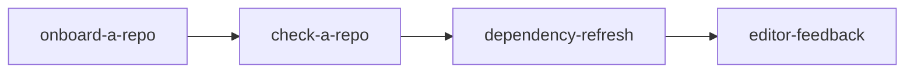

# linter — Product

> **Source of truth for why the product exists and what "good" means.** Lives
> at `docs/blueprint/product.md`, authored by `/vwf:product`. Code- and
> stack-independent: no technology, project, or screen names. Every flow's
> Purpose links the goal or goals that it serves.

## Problem

A developer who keeps many code repositories must install a code checker and
many language add-ons in each repository. Each repository must also keep these
add-ons up to date. The versions drift from repository to repository, and the
add-ons conflict with each other. Thus the same code gets different results in
different repositories, and each new repository repeats the setup work.

**Why now:** the number of repositories grows. Each new repository repeats the
setup and adds one more place where the versions can drift, so the cost
increases with each repository.

## Target users

| Persona            | Who they are                                                   | Core need                                                              |
| ------------------ | -------------------------------------------------------------- | ---------------------------------------------------------------------- |
| Repository owner   | The author, who keeps many repositories                        | One command that checks code the same way in each repository, no setup |
| Outside developer  | A developer who finds the tool on its public package page      | Start with one command, and trust the default rules                    |
| Editor user        | A developer who works in a code editor                         | See in the editor the same problems that the command line shows        |
| Automated pipeline | A job that runs the check on each change or before each commit | Stable results and a correct pass or fail status                       |

## Goals & success metrics

### Adoption in own repositories {#goal-own-repo-adoption}

- Outcome: each repository that the owner keeps checks its code with this one
  tool, with no per-repository add-ons.
- Metric: the share of the owner's active repositories that use the tool —
  target 100% within 3 months (by 2027-02-23).
- Measured via: external source-hosting account (a count of the owner's active
  repositories, and of the repositories among them that use the tool)
- Re-evaluate if: the share is below 50% by 2027-03-01 → kill / pivot /
  re-scope

### No drift from the core {#goal-no-drift}

- Outcome: the tool stays current with the packages that it bundles, and never
  blocks an upgrade of them.
- Metric: the number of days from a core release (a new version of any bundled
  package; a major version that the dependency policy holds is excluded) to a
  tool release that includes it — target 7 days or fewer for each core
  release, read each quarter. A week that a failed gate blocks counts against
  the target.
- Measured via: external package-registry release dates (of the bundled package
  and of the tool)

## Slice priority

| Rank | Slice (flow / entity)     | Serves goal                         | Validates | Why now                                                                    |
| ---- | ------------------------- | ----------------------------------- | --------- | -------------------------------------------------------------------------- |
| 1    | onboard-a-repo (flow)     | [Adoption](#goal-own-repo-adoption) | —         | Each new repository starts here; adoption needs a start with no setup work |
| 2    | check-a-repo (flow)       | [Adoption](#goal-own-repo-adoption) | —         | The check itself is the value that each repository uses each day           |
| 3    | dependency-refresh (flow) | [No drift](#goal-no-drift)          | —         | The release lag after a core release is the metric of goal 2               |
| 4    | editor-feedback (flow)    | [Adoption](#goal-own-repo-adoption) | —         | Users keep the tool only when the editor agrees with the command line      |

No slice validates the riskiest assumption (the first row of
[Risks & assumptions](#risks--assumptions), that one person can keep the owned
rules current). Its method is usage-data: the release lag after each core
release, which needs no slice. Onboarding goes first because adoption starts
there.

## Non-goals

- **Growth among outside developers.** The tool is public, but outside adoption
  is not a goal now. A public site waits until it is a goal.
- **Code formatting.** The tool checks code. It does not format code; a separate
  formatter does that.
- **Third-party rule packages.** The tool owns its rules. It does not add rule
  packages from outside sources.

## Risks & assumptions

| Assumption                                                             | Risk if wrong                                              | Validation method | Status   | Evidence |
| ---------------------------------------------------------------------- | ---------------------------------------------------------- | ----------------- | -------- | -------- |
| One person can keep the owned rules current with upstream              | The rules go stale, and goal 2 fails                       | usage-data        | untested | —        |
| One default rule set suits each repository that the owner keeps        | Repositories need many overrides, and adoption stops       | usage-data        | untested | —        |
| The editor shows the same problems as the command line                 | Users stop trusting the editor results, and adoption stops | prototype         | untested | —        |
| A large, self-contained download is acceptable for users and pipelines | Slow first runs push repositories away from the tool       | usage-data        | untested | —        |
